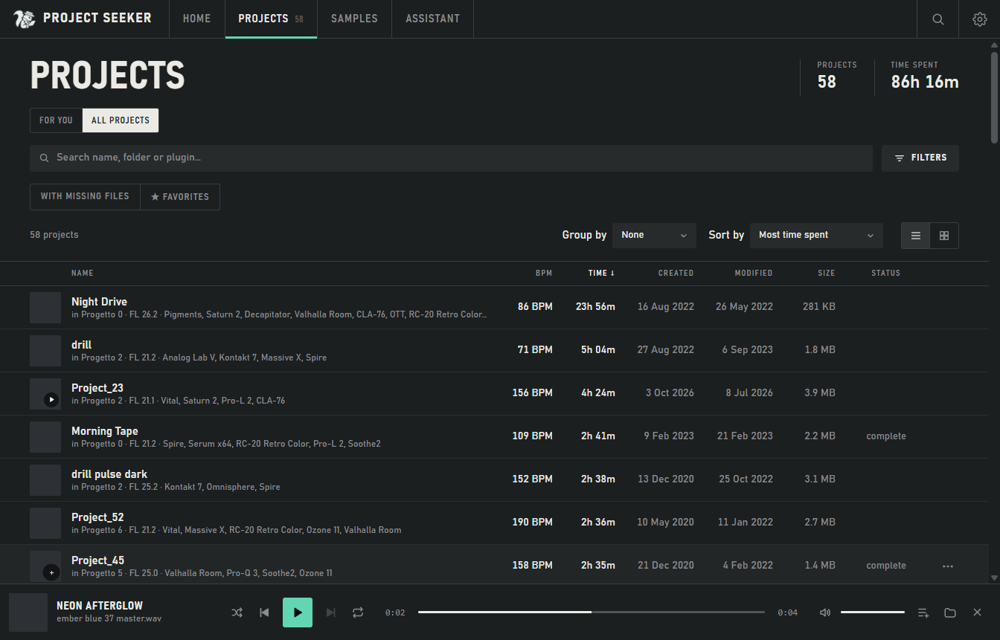

# Project Seeker

A free Windows app to **find an old idea, hear its audio export and reopen it in your DAW**. Browse FL Studio (.flp) and Ableton Live (.als) projects without modifying the originals.

For FL Studio, Project Seeker shows every beat with its BPM, FL version, creation date, time spent,
size, plugins and samples, including **which samples are missing** and in which projects. You can sort, filter,
tag and add notes, and see the library as an interactive bubble map.

For Ableton Live, the library shows the Live version, set tempo, track names and referenced audio files. Use the DAW filter in Projects to switch between formats. Project Seeker checks collected audio in the Live project and the absolute paths saved in the set. Reviver supports FL Studio.

Available in English, Italian, French and German (it follows the Windows language, or pick one in Settings).

## From an idea to a session

- Search your library by name, BPM, plugin, sample, tags or notes. Combine filters and save searches.
- Explore the **Bubble map**, project details and library statistics.
- Listen to associated **audio exports** with a queue, shuffle, repeat, waveform or EQ. The player does not render FLP or ALS files. You can choose an audio file when an automatic match is wrong or absent.
- Rediscover projects in **For you**; organize **albums and playlists** without moving files. Albums share their cover with their projects; playlists can overlap.
- Inspect missing samples and add kit folders. Matches by filename are candidates to verify, not proof that two sounds are identical.
- Optionally enable **Reviver beta** for FL Studio or configure the **assistant**. Neither is required for the library, search, collections or player.



All screenshots use made-up projects and temporary preferences. See the [getting started guide](docs/GETTING_STARTED.md) for the first scan, playback, collections and the three themes.

## Read only, always

- `.flp` and `.als` files and samples are only **opened for reading** or checked (does it exist? how big is it?).
- Project Seeker never moves, renames or saves anything in your project folders.
- "Organizing" the library changes the view, never the files.
- The only place it writes is `%APPDATA%\ProjectSeeker` (library, preferences, notes, what you listened to in the app, the albums and playlists you make in it, your Reviver notes, log, copies of the images you pick as covers, copies of the sounds you drop in Reviver; the originals stay where they are).
- Outside that folder it does one thing only, if you press "Link to FL" in Reviver (a beta feature, off until you turn it on in Settings): it adds the Reviver folder to the folders where FL Studio looks for sounds (the Browser extra search folders, in the Windows registry). "Unlink from FL" removes it.

## Download

Installers, when published, appear on the [Releases](../../releases) page. Check the release's test notes and signing status. Compare its SHA-256 with the downloaded file:

```
certutil -hashfile ProjectSeeker-setup-<version>.exe SHA256
```

Requirements: Windows 10 or 11 (64-bit) with Microsoft Edge WebView2 (already there on most PCs; if it is missing,
the app tells you and opens the download page). The installer works without administrator rights.

## Supported FL Studio versions

Earlier local checks covered bundled FL Studio projects saved by FL 10.9–26.1 and real libraries from FL 21–26.1. The automated suite also uses synthetic damaged files and version boundaries. These checks do not guarantee every project or plugin version. If a project shows as "partially read", report the DAW version and the error; you do not need to upload your music.

Ableton support reads tempo, Live version, track names and referenced audio, including collected audio after a project moves. Earlier local checks covered Live 11/12 sets; a broad compatibility test across Live versions is still pending. FL working hours are unavailable for Ableton. Reviver currently supports FL Studio only and is **off by default**.

## Run from source

```
pip install -r requirements.txt
python app.py
```

`python test_reader.py` checks the .flp reader on the files in `test/`.
`python test_scan.py` checks the scan on temporary folders: damaged files, a file that blocks, cloud-only files, long paths, copies and backups.
`FILTRO_RICERCA.md` describes the search filter (the JSON behind the search bar).
`run.bat` opens the source version. `build.bat` builds the app folder (PyInstaller) and, if Inno Setup 6 is installed, the installer and its checksum file. A successful build is not an installation or playback test.
`load_test.bat` opens the app with 20,000 made-up projects (in memory only), to check that it stays fast.
Windows and Mac packaging now start from this folder; see [local distribution procedures](DISTRIBUTION.md).
`python test_release_ui.py --preview welcome` opens an isolated first-run preview with synthetic data; it never loads the personal library. `--screenshots` regenerates the images in this guide.
`python -m unittest test_debug test_assistant`, `node --test test_data_ui.js` and `node test_assistant_controls.js` cover data, assistant privacy, UI logic and translations. The assistant transport tests use a synthetic localhost server, not a real provider.

## Contributing

Issues and pull requests are welcome. Pull requests from people outside the team are reviewed before merging.
The golden rule for any change: the app must never write to, move or rename a user's projects or samples.

Translations live in `ui/lang/` (one file per language, the key is the Italian text used in `ui/index.html`).
The French and German ones have not been checked by a native speaker yet: corrections are very welcome.

## Code signing policy

Code signing through SignPath is planned; it must not be assumed to be active. Local builds are unsigned unless explicitly signed and verified. Check the actual release before relying on a publisher identity.

- Committers and reviewers: [Repository contributors](../../graphs/contributors)
- Signing approver: the project maintainer

The workflow supports submitting only this repository's `ProjectSeeker.exe` and installer to SignPath once the service and credentials are configured. Signing requests require manual approval. This describes the intended process, not evidence of a signed release.

## Privacy policy

This program will not transfer any information to other networked systems unless specifically requested
by the user or the person installing or operating it.

Scanning, organizing, reading project details and playing audio work offline. The app makes no network requests
when it starts or scans a library. Its audio player uses a local-only server on this PC. The optional assistant can
use a model already running on this PC; an external assistant requires an internet connection.

In practice: Project Seeker has no account, no telemetry and no ads. The search buttons for a missing sample
(Google, YouTube, Splice, Freesound, Looperman) open that site in your browser with the sample name as the search text.
If you configure the optional assistant with an external API, the current message is sent to your chosen provider. Without the separate library-sharing consent, project facts and chat history are excluded. Normal chat does not attach the library even when sharing is enabled. Explicit Search, Create and Wrapped modes use only the relevant permitted metadata; Create suggests musical ideas and does not create files. The assistant does not listen to audio.

A model running entirely on this PC can use library data locally. A localhost endpoint may itself forward requests to an external service; the Cloud/Local label is not proof of where inference runs. API keys are encrypted for your Windows account,
stored in the app data folder and never included in library preferences. Assistant conversations are saved locally in
the app data folder without encryption; they may contain project names and paths and can be deleted from the assistant screen.

## Licenza

Copyright (C) 2026 Gato. Project Seeker is licensed under the GNU General Public License version 3 (GPL-3.0-only).
See [LICENSE](LICENSE) for the complete, unmodified official license text.
You may use, modify and redistribute the app, including commercially, under the GPL's conditions; no warranty is provided.
Third-party components retain their own licenses; see [dependency licenses](docs/DEPENDENCY_LICENSES.md).

## Crediti

[PyFLP](https://github.com/demberto/PyFLP), by demberto and contributors, is a reference for the FL Studio project format.
Its source headers permit GPL version 3 or later. Project Seeker currently uses its own parser and does not import PyFLP.
Built with [pywebview](https://pywebview.flowrl.com) and [PyInstaller](https://pyinstaller.org); the installer uses
[Inno Setup](https://jrsoftware.org/isinfo.php). Familjen Grotesk and JetBrains Mono retain their
[SIL Open Font License](ui/fonts/OFL.txt). FL Studio is a trademark of Image-Line; this project is not affiliated with Image-Line.

