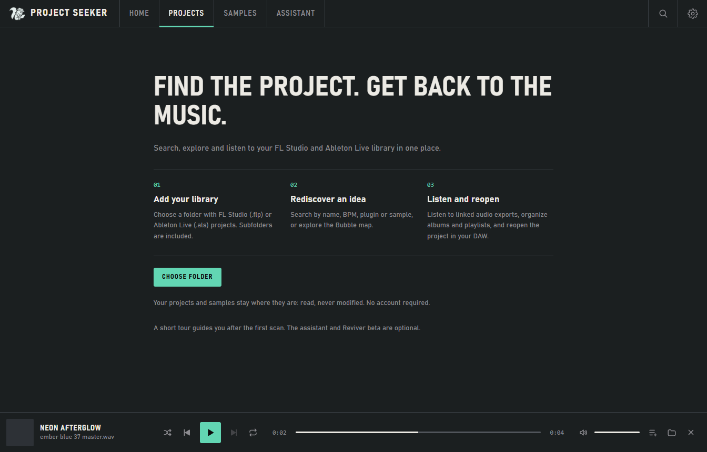
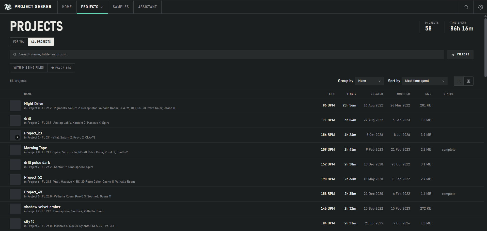
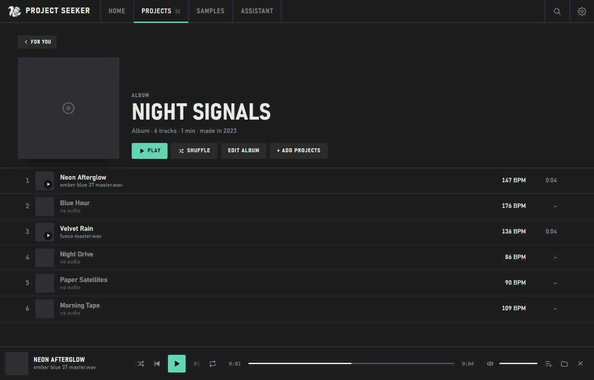
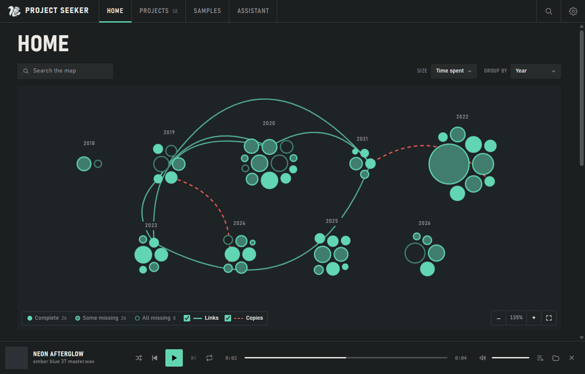

# Your first session with Project Seeker

Project Seeker helps you rediscover music projects on Windows. Your original projects and samples are read, never moved, renamed or saved by the app. You can use its library, map, collections and player without an account or an AI model.

## Add a library

Choose a folder containing `.flp` or `.als` files. Subfolders are included. Wait for the scan; its progress shows what is being read. Cancel stops the current folder without replacing its previous results. Already completed folders can remain updated.

After your first useful scan, a short tour introduces the main sections. Skip it or press Esc to close it; replay it in Settings → General. Use Scan to add other project folders or kit folders and refresh the index. If a folder cannot be read, the app retains the previously indexed inaccessible parts and offers Retry. Cloud-only files must be downloaded by your sync app before they can be read.

## Find, listen, reopen

Open Projects → All projects. Search a name, plugin or sample, or use Filters for BPM, DAW, dates and other criteria. Criteria combine; Reset filters recovers an empty result. Similar-word matches are named beside the result count. Select a project for its details; Open in FL Studio or Ableton Live uses the installed DAW and Windows file association.

The play button uses an associated audio export. FLP and ALS files themselves contain project instructions and are not playable by this player. In the details, Export candidates lists possible audio matches. The percentage estimates a link using the filename, dates and folder; it is not audio recognition or proof. Listen and verify, or use Choose file… to associate an export yourself. Missing play buttons can simply mean there is no supported audio associated yet. WebView2 cannot play every audio format or codec.

The bottom player has previous/next, queue, shuffle, repeat and volume. Its sequence follows the list, album or playlist you started from and skips projects without audio. Playback can continue while you explore another section. The player records an app listen after 30 seconds; it does not track DAW activity or plays in other apps.

## Understand the details

- **–** means unavailable, not zero. A zero value means the file actually reports zero. FL working hours describe the value saved in the file; Live does not provide it.
- **Missing** means the indexed path could not be resolved in the checked locations. An unavailable disk or permissions can affect this. The details retain the path so you can investigate and rescan.
- **Found by name / probably found** is a candidate. Different audio files can share a name; verify before using a replacement.
- **Partially read** means some data was recovered but the reader could not interpret the whole file. A failed read does not mean the original file was modified.
- **Complete** concerns the sample checks Project Seeker can perform. It does not certify installed plugins, licenses or a successful load in the DAW.

## Organize an EP or a listening session

Use a project's menu to add it to an album or playlist; Ctrl+click and Shift+click support multiple projects. Find your collections in Projects → For you. A project belongs to one album and can appear in several playlists. Collection names, order, descriptions and covers are stored in the app, leaving disk folders unchanged. Removing an album does not delete the projects.

## Explore the map and choose your appearance

The Bubble map is another view of the same library. Explore connections and select bubbles for project information. Use the Projects list for keyboard access to individual projects.

Settings → Appearance offers Light, Dark, Black, an accent and three text sizes. The app follows Windows reduced-motion preferences for interface transitions, map magnets and the animated EQ (which becomes a progress line). Your saved EQ choice remains available when reduced motion is disabled.

[Light theme](screenshots/projects-light.png) · [Black theme](screenshots/projects-black.png)

## Optional tools

**Reviver is beta, FL Studio only, and off by default.** Enable it in Settings if you want to try its missing-sample workflow. It copies selected sounds into the app's Reviver folder, preserving the originals. Link to FL changes FL Studio's extra search folder setting in the Windows registry; Unlink removes that link. Saving a reopened project inside FL Studio is your separate action.

**The assistant is optional.** Configure a model or compatible API in Settings. Normal chat sends your message without library context. Select Search projects, Create (musical ideas, not files) or Wrapped explicitly. An external provider needs separate consent to receive library facts. Typed messages still go to the configured provider; a localhost proxy may forward them elsewhere. The assistant never receives audio. See [assistant behavior and privacy](ASSISTANT.md).

## Your data

Preferences, tags, notes, collections, local chat history, covers and Reviver copies live in `%APPDATA%\ProjectSeeker`. Chat history is stored without encryption; API keys use Windows account encryption. Uninstalling preserves this folder. There is no telemetry or mandatory service. Search-online buttons open the chosen website in your browser with the sample name.

All images in this guide use synthetic projects and temporary preferences. They illustrate the interface, not a real music library or proof of DAW compatibility.
